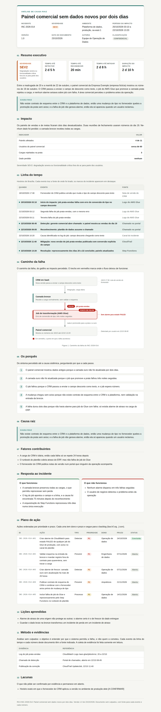

# rca-incidentes

Skill de **análise de causa raiz (RCA) de incidente**, sem culpados. Coleta a evidência somente
em leitura, monta a linha do tempo com a fonte de cada evento, mede o tempo até detectar e até
resolver, conduz os porquês até a causa sistêmica e gera um documento HTML autocontido, a figura
do caminho da falha em SVG e o backlog de ações com dono e prazo.

Funciona como skill no Claude Code e no Kiro, e também como um conjunto de scripts de linha de
comando. Só depende da biblioteca padrão do Python 3.8+.



## O que o documento traz

Resumo executivo com severidade e métricas, impacto, linha do tempo com fonte, caminho da falha,
os porquês, causa raiz, fatores contribuintes, resposta ao incidente, plano de ação com dono e
prazo, lições aprendidas, método e evidências, e lacunas. A página é única e autocontida: CSS e
SVG embutidos, nenhuma chamada de rede, tema claro e escuro conforme o sistema, tabelas que viram
cartões em tela estreita e versão própria para impressão (imprimir para PDF no navegador).

## Instalação

```bash
git clone <url-deste-repositório> ~/rca-incidentes
for dest in ~/.claude/skills ~/.kiro/skills; do
  mkdir -p "$dest"
  ln -sfn ~/rca-incidentes "$dest/rca-incidentes"
done
```

No Windows, pelo PowerShell, com junção de diretório:

```powershell
git clone <url-deste-repositório> "$HOME\rca-incidentes"
foreach ($dest in "$HOME\.claude\skills", "$HOME\.kiro\skills") {
  New-Item -ItemType Directory -Force -Path $dest | Out-Null
  New-Item -ItemType Junction -Path "$dest\rca-incidentes" -Target "$HOME\rca-incidentes" -Force | Out-Null
}
```

Requisitos: Python 3.8+ e, para a coleta, AWS CLI ou Azure CLI autenticadas.

## Como usar

Na ferramenta em que a skill está instalada, descreva o incidente:

```text
faz o RCA do incidente de ontem na plataforma de dados, perfil prd-leitura,
começou por volta das 3h e foi resolvido às 13h20; o chamado e o canal estão nestes prints
```

A skill confirma o recorte, coleta a evidência em leitura, escreve o `incidente.json`, valida,
monta e entrega o documento, as métricas, a causa raiz em uma frase e o backlog.

Pelo terminal, com o exemplo:

```bash
python3 scripts/valida_incidente.py examples/empresa-exemplo/incidente.json
python3 scripts/monta_rca.py examples/empresa-exemplo/incidente.json --saida examples/empresa-exemplo/out
```

Coleta (sempre teste antes com `--dry-run`):

```bash
python3 scripts/coleta_aws.py --perfil prd-leitura --regiao sa-east-1 \
  --inicio 2026-10-19T12:00 --fim 2026-10-22T14:00 --saida coleta/ --dry-run
python3 scripts/coleta_azure.py --assinatura <id> --grupo <rg> \
  --inicio 2026-10-19T12:00 --fim 2026-10-22T14:00 --saida coleta/ --dry-run
```

## Estrutura

| Caminho | O que é |
|---|---|
| `SKILL.md` | O fluxo e as regras da skill |
| `references/metodo.md` | Sem culpados, severidade, marcos, porquês, ações, caminho da falha, campos do incidente.json |
| `references/coleta.md` | O que cada coletor lê e as permissões necessárias |
| `scripts/comum.py` | Horários, durações, marcos, severidades |
| `scripts/coleta_aws.py`, `scripts/coleta_azure.py` | Coleta somente em leitura, com `--dry-run` |
| `scripts/valida_incidente.py` | Conferência do incidente.json |
| `scripts/figura.py` | Desenho do caminho da falha em SVG |
| `scripts/monta_rca.py` | Gera `rca.html`, `caminho_falha.svg`, `linha_do_tempo.json` e `backlog.json` |
| `examples/empresa-exemplo/` | Incidente fictício completo, com o documento e a figura gerados |

## Exemplo

O exemplo é de uma empresa fictícia, a Empresa Exemplo: o painel comercial ficou dois dias sem
dados novos porque o CRM mudou o tipo de um campo, o job que promove a camada prata passou a
falhar e nenhum alarme avisava sobre job com falha. A saída gerada está em
`examples/empresa-exemplo/rca.html` e `examples/empresa-exemplo/caminho_falha.svg`.


## Licença

MIT. Veja [LICENSE](LICENSE).
